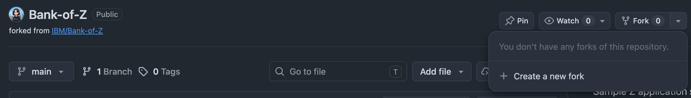
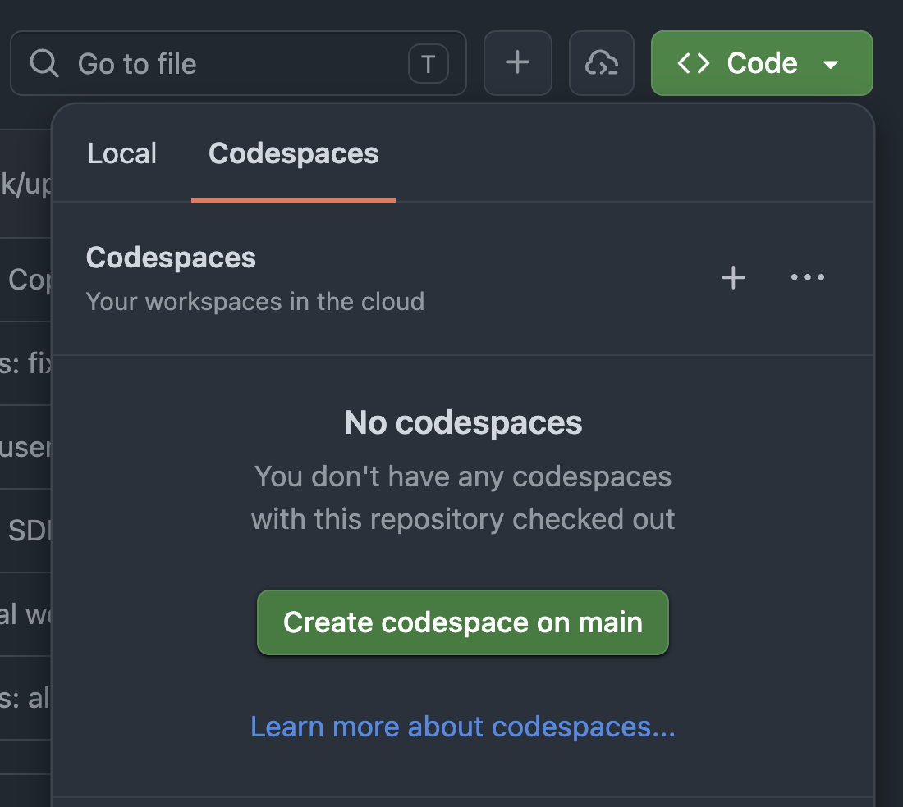
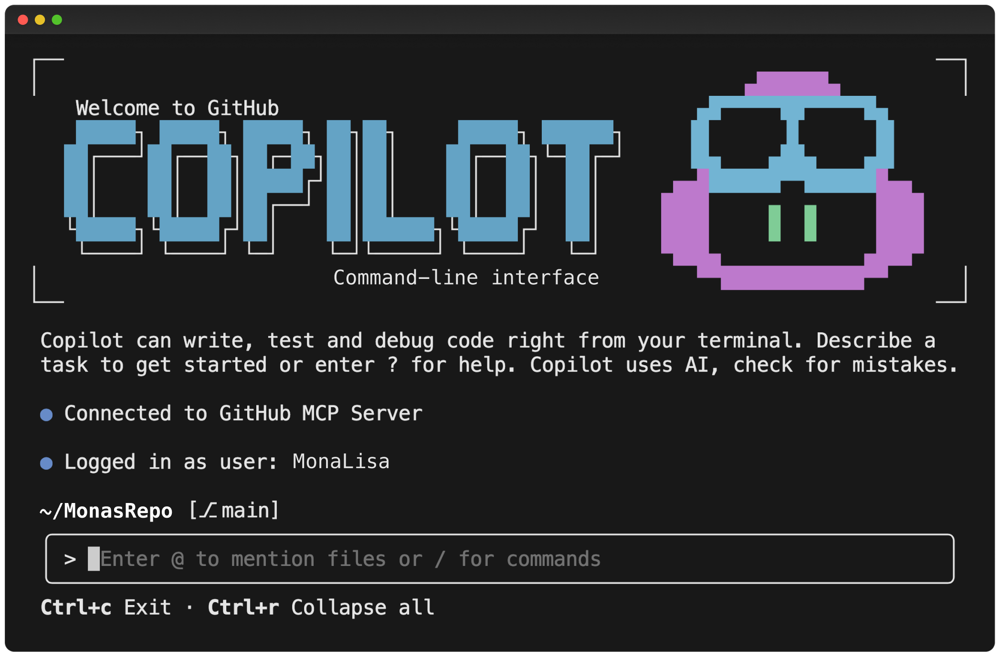

# GitHub Copilot for Mainframe Modernization

<style>:root{--text-base-size:17px}html{font-size:var(--text-base-size)}.container{max-width:1200px!important}</style>

*Version 1.1 — Oct 2026*

Welcome! This workshop has two parts:

1. **Getting Started with GitHub Copilot**: a single broad chapter for anyone who has never (or barely) used GitHub Copilot. It covers inline completions, Chat, Agent mode, agent harnesses, the Copilot CLI, custom instructions, prompt files, custom agents, skills and MCP servers.
2. **Mainframe App Modernization**: how to use GitHub Copilot to modernize a mainframe application *without losing the business rules baked into it*. You work through four phases — rediscovery, substitution audit, re-architecture/re-write and deployment — on IBM's [Bank of Z](https://github.com/IBM/Bank-of-Z) with a pre-built kit of custom agents, prompt files and skills. A deterministic COBOL parser ([cobol-rekt](https://github.com/avishek-sen-gupta/cobol-rekt)) builds a *source of truth* that every LLM-written claim is checked against.

<div class="info" data-title="Who is this for?">

> Mainframe developers, modernization architects and tech leads who want to use agentic AI on COBOL / CICS / DB2 / IMS code bases — and want to know where it helps, where it fails, and how to tell the difference. No prior GitHub Copilot experience is required; Chapter 1 is designed to help you catch up fast. General understanding of Agentic AI will help. Basic COBOL reading skills help, but are not mandatory.

</div>

<div class="info" data-title="No mainframe required">

> Everything in this workshop runs on your laptop or in a GitHub Codespace against the *source code* of Bank of Z. You do **not** need access to z/OS, CICS, DB2 or IMS. The agents are explicitly told not to try to compile, deploy or run anything on a mainframe.

</div>

<div class="warning" data-title="Heads up">

> GitHub Copilot evolves quickly. UI labels, menu locations and feature names may shift between releases. If something looks slightly different in your VS Code, search the Command Palette (macOS `Cmd+Shift+P`, Windows `Ctrl+Shift+P`) — the feature is almost certainly still there.

</div>

<div class="info" data-title="🗄️ Database marker">

> Wherever you see the 🗄️ marker in this workshop, the data layer is in play — DB2 tables, IMS databases, VSAM/CICS files, or a migration decision worth pausing on. Treat it as a "stop and think about the data" cue.

</div>

---

<style>:root{--text-base-size:17px}html{font-size:var(--text-base-size)}.container{max-width:1200px!important}</style>

## Pre-requisites

You need the following before starting:

|  |  |
| --- | --- |
| A GitHub account | [Create free GitHub account](https://github.com/join) |
| GitHub Copilot access | Free, Pro, Business or Enterprise — see below |
| Visual Studio Code | [Download](https://code.visualstudio.com/). Chats in this workshop use the **Local** agent harness (see 1.1) |
| GitHub Copilot extension(s) in VS Code | [GitHub Copilot](https://marketplace.visualstudio.com/items?itemName=GitHub.copilot) and [Copilot Chat](https://marketplace.visualstudio.com/items?itemName=GitHub.copilot-chat) |
| Java 21+ | Any JDK, e.g. [Microsoft Build of OpenJDK](https://learn.microsoft.com/java/openjdk/download) |
| Python 3.9+ | [Install](https://www.python.org/downloads/) |
| GitHub CLI | [Install](https://cli.github.com/) |
| GitHub Copilot CLI | [Install](https://github.com/github/copilot-cli) |
| A terminal | bash or zsh. On Windows use **Git Bash** or **WSL** — the agent skills ship as bash scripts |
| IBM Z Open Editor *(optional)* | [VS Code extension](https://marketplace.visualstudio.com/items?itemName=IBM.zopeneditor) — COBOL syntax highlighting, outline and copybook navigation |
| A fork of Bank of Z | [Fork `jkordick/Bank-of-Z`](https://github.com/jkordick/Bank-of-Z/fork), then clone your fork locally or open it in a GitHub Codespace (see below). It is IBM's Bank of Z plus a ready-made `.github/` folder (agents, prompts, skills, instructions) for this workshop |



**Working in a Codespace instead of locally?** On *your fork*, select **Code** → **Codespaces** → **Create codespace on main**. The fork ships a [dev container](https://github.com/jkordick/Bank-of-Z/blob/main/.devcontainer/devcontainer.json) with everything this workshop needs: Java 21, Python 3.12, the GitHub CLI, the GitHub Copilot CLI and the Copilot, Copilot Chat and IBM Z Open Editor extensions. The first build takes a few minutes. The codespace then opens VS Code in the browser with your fork checked out. You can skip installing the tools from the table above.



<div class="tip" data-title="Why a fork of a fork?">

> [`jkordick/Bank-of-Z`](https://github.com/jkordick/Bank-of-Z) is [IBM/Bank-of-Z](https://github.com/IBM/Bank-of-Z) unchanged, plus `.github/agents`, `.github/prompts`, `.github/skills`, `.github/copilot-instructions.md` and a `.devcontainer` for Codespaces. Forking it gives you your own copy to commit modernization artifacts to as you do not have the rights to commit to [`jkordick/Bank-of-Z`](https://github.com/jkordick/Bank-of-Z).

</div>

### Getting Copilot access

- **Individual Free/Pro:** sign up at [github.com/github-copilot/signup](https://github.com/github-copilot/signup).
- **Through your organization:** request access at [github.com/settings/copilot](https://github.com/settings/copilot).

<div class="info" data-title="Enterprise organization check">

> Some features in this workshop (Agent mode, MCP, the GitHub Copilot CLI) may be restricted by your organization's policy. The workshop is structured so that each section is **independently useful**; skip what you cannot use.

</div>

---

<style>:root{--text-base-size:17px}html{font-size:var(--text-base-size)}.container{max-width:1200px!important}</style>

# Chapter 1 — Getting Started with GitHub Copilot

> If you have never (or only barely) used GitHub Copilot, **start here**. This chapter is intentionally broad. Skip (parts of) it if you are already familiar and comfortable.

Every exercise in this chapter uses your fork of Bank of Z. Open it in VS Code before you start.

<div class="info" data-title="Bank of Z in one minute">

> Bank of Z is IBM's sample hybrid banking application. Customers are routed to **CICS** (COBOL + DB2, 3270 screens) or **IMS** (COBOL / PL/I / Java + DL/I databases) depending on their customer ID; a **batch** job produces monthly statements; **z/OS Connect** exposes both sides as REST APIs. The CICS programs live in `src/base/cics/cobol/`, copybooks in `src/base/*/copy/`, IMS in `src/base/ims/`, batch in `src/base/batch/`.

</div>

## 1.1 Copilot in VS Code

<div class="warning" data-title="Use the Local harness for this workshop">

> VS Code can run chat sessions in different [agent harnesses](https://code.visualstudio.com/docs/agents/run/agent-harnesses). The default is **Copilot**, the same runtime as the Copilot CLI. This workshop relies on **prompt files** (1.4, Chapter 2), and the Copilot harness [does not load `*.prompt.md` files](https://code.visualstudio.com/docs/agent-customization/migrate-customizations#_convert-prompt-files-to-skills). Only the **Local** harness does. For every chat in this workshop:
>
> 1. In the Chat view, select **New Chat** (`+`).
> 2. Open the **Session Target** picker in the chat input and select **Local**.
> 3. Check: the chat title now starts with *Local*.
>
> Pick the harness **before** you send the first prompt. A Local session can later be handed off to another harness, but it can't come back to Local, so if you picked the wrong one, start a new chat. Local is only available in the editor's Chat view, not in the Agents window. Custom instructions, custom agents, skills and `.vscode/mcp.json` all work in Local.

</div>

<div class="tip" data-title="Local is not in the Session Target picker?">

> Update VS Code and the Copilot extensions first. If Local is still missing, add these (experimental) settings to your user `settings.json`, as described in the [agent harness FAQ](https://code.visualstudio.com/docs/agents/run/agent-harnesses#_can-i-keep-local-available-while-migrating):
>
> ```json
> {
>   "chat.editor.localAgent.enabled": true,
>   "chat.defaultToCopilotHarness": false,
>   "chat.editor.preferCopilotHarness": false
> }
> ```
>
> Organization policy can override these settings, hide Local, or automatically move a Local session to the Copilot harness. If that happens on a managed machine, ask your administrator, or use the CLI path described in 1.4 and 2.6.1.

</div>

You will use four surfaces:

### Inline completions

Start typing and Copilot suggests grey inline completions. The default VS Code shortcuts (see [Keyboard shortcuts for GitHub Copilot](https://docs.github.com/en/copilot/reference/keyboard-shortcuts)):

| Action | macOS | Windows |
| --- | --- | --- |
| Accept suggestion | `Tab` | `Tab` |
| Dismiss suggestion | `Esc` | `Esc` |
| Next suggestion | `Option+]` | `Alt+]` |
| Previous suggestion | `Option+[` | `Alt+[` |
| Trigger suggestion | `Option+\` | `Alt+\` |
| Open more suggestions in a separate pane | `Ctrl+Enter` | `Ctrl+Enter` |

> Tip: Check your configured shortcuts via the Command Palette (macOS `Cmd+Shift+P`, Windows `Ctrl+Shift+P`) -> `Preferences: Open Keyboard Shortcuts`.

**Try it.** Create a scratch file `INTCALC.cbl` in the repo root and type (fixed format — code starts in column 8):

```cobol
       IDENTIFICATION DIVISION.
       PROGRAM-ID. INTCALC.
      * computes monthly interest for a savings account balance
      * using an annual interest rate given in percent
       DATA DIVISION.
       WORKING-STORAGE SECTION.
```

Let Copilot propose the data items, then type `       PROCEDURE DIVISION.` and let it complete the body. Now add an 88-level to the working storage, e.g.

```cobol
       01 WS-ACCOUNT-TYPE        PIC X(8).
          88 ACCOUNT-IS-ISA      VALUE 'ISA'.
```

and a comment `* ISA accounts get a 0.5 percent bonus rate` in the procedure division then watch how *prior context in the file* steers the next suggestion. Check what the suggestion does. If you are not happy with the output try adding more context in form of comments. Delete the scratch file afterwards.

### Inline chat (macOS `Cmd+I`, Windows `Ctrl+I`)

Open `src/base/cics/cobol/XFRFUN.cbl` (the funds-transfer back-end), select the `UPDATE-ACCOUNT-DB2-FROM SECTION` (around line 919), press `Cmd+I` (macOS) / `Ctrl+I` (Windows) and ask: *"add comments explaining the SQLCODE handling"*. Review the diff before you accept or discard it. 

### Chat view (macOS `Ctrl+Cmd+I`, Windows `Ctrl+Alt+I`)

The Chat view is where you talk to agents next to your code. Before you send the first prompt of a session, the chat input lets you pick four things: the **Session Target** (the agent harness, see *Agent harnesses* below), the **Agent** (Ask, Agent, Plan or one of your custom agents), the **Language model** (or *Auto*) and the **Permissions** level.

With the **Ask** agent selected, chat is for conversation about your code. Use `#` to attach context (files, symbols, selection) and type `/` to see the commands available in the current session (e.g. `/explain`, `/fix`, `/tests`, `/plan`, `/compact`). Which commands show up depends on the harness and agent you picked.

```text
#file:src/base/cics/cobol/XFRFUN.cbl /explain how a transfer is validated
```

Ask a follow-up: *"which DB2 tables does it read and write, and in which order?"* 🗄️

> **In the Copilot CLI:** attach files with `@` (not `#`) and just ask in plain language — there is no `/explain` or `/fix`. Slash commands in the CLI are for the session itself (`/agent`, `/mcp`, `/context`, `/compact`, `/usage`, `/resume`, `/cwd`, `/add-dir`). Prefix a line with `!` to run a raw shell command without invoking the model.

### Agent mode

In a Local chat, switch the agent picker from **Ask** to **Agent**. Agent mode can read, create and edit files across your workspace, run commands (with your approval) and iterate until a task is done. This is the surface you will lean on most in Chapter 2.

**Try it.** In Agent mode, ask:

```text
Read src/base/cics/cobol/BNKMENU.cbl and draw a mermaid diagram of every program it LINKs or XCTLs to and every transaction it hands control to. Cite file:line for every arrow. Do not change any files.
```

Keep the answer — you will compare it with a deterministic tool output in 1.6.

<div class="tip" data-title="Pick the right built-in agent">

> - **Ask** — questions, explanations, information gathering (read-only tools)
> - **Plan** — research a task and produce an implementation plan for you to review (also via `/plan`)
> - **Agent** — autonomous task execution, coding, execution

</div>

> **In the Copilot CLI:** there is no Ask/Agent toggle — the CLI is always agentic. Cycle into *plan mode* with `Shift+Tab` (macOS and Windows) to design before changes are made, and use `--allow-all` (or `--yolo`) for unattended runs where you accept the risk of skipping approval prompts.

### Agent harnesses

An **agent harness** is the software layer that turns a model into an agent: it runs the agent loop, wires up tools and approvals, and decides **which customization files it loads**. You pick it per session with the **Session Target** control, *before* the first prompt.

| Session Target | What runs | What it means for this workshop |
| --- | --- | --- |
| **Copilot** (VS Code default) | The shared Copilot runtime (Copilot SDK), the same one behind the Copilot CLI and the GitHub Copilot app. Runs in the Agent Host, so sessions can continue in the background and in other interfaces. | Reads `.github/copilot-instructions.md`, `AGENTS.md`, `.github/instructions/`, `.github/agents/`, `.github/skills/` and MCP servers. **Does not load prompt files (`.prompt.md`)**, so the Chapter 2 kit doesn't run here. |
| **Local** (use this one) | VS Code's built-in harness, running in the editor's extension host. The session is tied to the editor window. | Supports instructions, custom agents, skills and MCP **plus** prompt files, custom agent handoffs and the `/init` and `/create-*` shortcuts. |
| **Claude** / **Codex** | Provider harnesses (Anthropic Claude Agent SDK, OpenAI Codex). | Use their own config locations (`CLAUDE.md`, `.claude/`, `.agents/`). Often disabled by enterprise policy. Not used in this workshop. |
| **Cloud** | The Copilot harness on managed cloud compute. An execution target, not a separate harness (experimental). | Same customizations as Copilot, in a separate cloud workspace. Not used in this workshop. |

<div class="info" data-title="Model ≠ harness">

> Changing the model or the agent (Ask / Plan / Agent / custom) does **not** change the harness. Selecting a Claude model in a **Copilot** session still uses the Copilot harness. Whenever a customization "does nothing", first check the chat title prefix to see which harness you are in.

</div>

## 1.2 GitHub Copilot CLI


GitHub Copilot is IDE independent and available via the CLI. It gives you an agent setup in your terminal — handy when your mainframe sources live on a build server or jump host without a GUI. The CLI runs the same Copilot runtime as the **Copilot** harness in VS Code, so instructions, custom agents, skills and MCP servers work in both. Prompt files don't.

**Try it.** After the installation, `cd` into your Bank of Z clone, run `copilot --banner` and ask:

```text
What is this repository about? Which business flows go via CICS and which via IMS?
```

<div class="warning" data-title="Command line tool execution">

> Especially when you run command line tools, always review the execution before accepting it. **Never blindly execute** suggested shell commands (in general).

</div>

## 1.3 copilot-instructions & AGENTS.md

GitHub Copilot reads project-level instructions from `.github/copilot-instructions.md`. There is always only one `copilot-instructions.md` per repository and it needs to be located exactly at `.github/`. You can create more specific instructions in `.github/instructions/*.instructions.md` (e.g. a `cobol.instructions.md`); the scoped files use a frontmatter `applyTo` glob to limit themselves to matching paths (e.g. `applyTo: "**/*.cbl"`). GHCP also interacts with `AGENTS.md` files. You can have multiple of these in your repo. Instructions from `AGENTS.md` files are merged from the repository root downwards to the closest one (e.g. `src/base/cics/AGENTS.md`, `src/base/ims/AGENTS.md`). The file always needs to be named exactly `AGENTS.md`.

Two things to keep in mind for both `copilot-instructions.md` and `AGENTS.md`:
1) the information in them should be relevant in *every* context the agent will operate in (because every interaction will load them), and
2) write them so they are verifiable. Avoid vague statements like *"write good code"* or *"follow best practices"*. Stick to rules that can be checked (e.g. "money is `PIC S9(10)V99`, never floating point"); plus concrete paths to files and folders the agent should or should not touch.

Your fork ships with one [`.github/copilot-instructions.md`](https://github.com/jkordick/Bank-of-Z/blob/main/.github/copilot-instructions.md). Open and read it. Notice it is short, declarative and project-scoped: a layout table (where CICS, IMS, batch, copybooks and DDL live), fixed-format COBOL conventions, how errors flow (COMMAREA flags vs. `RESP`/`SQLCODE` → `ABNDPROC`), and work rules like *cite `file:LINE`* and *never guess transaction IDs*.

<div class="info" data-title="Harness differences">

> - **Local harness** (this workshop): attaches the root `AGENTS.md` by default. Nested `AGENTS.md` files such as `src/base/cics/AGENTS.md` are only discovered when you set both `chat.useAgentsMdFile` and the experimental `chat.useNestedAgentsMdFiles` to `true`. Personal instructions are stored in your VS Code profile.
> - **Copilot harness and Copilot CLI:** discover `AGENTS.md` files at the repo root, in the working directory and in every folder in between. Personal always-on instructions live in `~/.copilot/copilot-instructions.md`, personal scoped ones in `~/.copilot/instructions/`.
> - Run **Chat: Open Customizations** to manage all customizations in one place. It shows the ones for the harness that is currently selected.

</div>

> **In the Copilot CLI:** the same files are picked up automatically — `.github/copilot-instructions.md`, `.github/instructions/**/*.instructions.md` and `AGENTS.md` — when you launch `copilot` inside the repo. No additional configuration needed.

## 1.4 Prompt files

Prompt files (`*.prompt.md`) are **reusable prompts** stored in your repo under `.github/prompts/`. In a **Local** chat they show up as slash commands. See [Use prompt files in VS Code](https://code.visualstudio.com/docs/agent-customization/prompt-files).

Create `.github/prompts/explain-program.prompt.md`:

<div class="tip" data-title="Tip">

> Create it by hand, run **Chat: New Prompt File** from the Command Palette (macOS `Cmd+Shift+P`, Windows `Ctrl+Shift+P`), or open **Chat: Open Customizations** → *Prompts*. In a Local chat you can also type `/create-prompt` to let Copilot generate one.

</div>

```markdown
---
name: explain-program
description: Explain one COBOL program in a fixed, reviewable structure
argument-hint: Program name, e.g. INQCUST
agent: agent
tools: ['read', 'search']
---
Explain the COBOL program named in the chat input. If no program name was given, ask for one before reading any files. Find it under `src/base/`.
Answer with exactly these sections and cite `path/to/file:LINE` for every claim:

1. **Purpose** — one paragraph, business language.
2. **Inputs** — COMMAREA / LINKAGE fields and the copybooks that define them.
3. **Outputs** — fields set on return, files/tables written.
4. **CICS / DB2 / DL/I calls** — every EXEC CICS, EXEC SQL and DL/I call, in order.
5. **Abend handling** — which RESP / SQLCODE values lead to an ABEND or to ABNDPROC, and with which abend code.

If something cannot be determined from the code, write "unknown" — do not guess.
```

Run it in a Local chat with `/explain-program INQCUST`, then `/explain-program DBCRFUN`. Two other ways to run a prompt file:

- Run **Chat: Run Prompt** from the Command Palette and pick the prompt.
- Open the prompt file and select the play button in the editor title bar.

<div class="tip" data-title="Prompt not showing up?">

> 1. Check the chat title. If it doesn't start with *Local*, you are not in the Local harness, and prompt files are ignored. Start a **New Chat** (`+`) and select **Local** in the **Session Target** picker (see 1.1).
> 2. Check that the file is in `.github/prompts/` and ends in `.prompt.md`.
> 3. Still missing? In the Chat view, select **…** → **Show Agent Debug Logs** (or run **Developer: Open Agent Debug Logs**) to see which customization files were loaded.

</div>

Prompt files are the *primitive* the whole modernization kit in Chapter 2 is built on.

> **In the Copilot harness and the Copilot CLI:** `.prompt.md` files are not loaded. Pick a custom agent (1.5) and paste the prompt body, or turn the prompt into a user-invoked skill (see the end of 1.6).

## 1.5 Custom agents

Custom agents (`*.agent.md`) let you create specialized Copilot personas with tailored expertise, tool access and instructions. Store them in `.github/agents/` at the repo level. They are available in VS Code, on github.com and in the Copilot CLI.

Create `.github/agents/cobol-reviewer.agent.md`:

<div class="tip" data-title="Tip">

> Run **Chat: New Custom Agent** from the Command Palette (macOS `Cmd+Shift+P`, Windows `Ctrl+Shift+P`), or open **Chat: Open Customizations** -> **Agents** -> **New Agent**. Select **Local** first, because the editor offers storage locations based on the selected harness.

</div>

```markdown
---
name: cobol-reviewer
description: Reviews COBOL programs for risky patterns without modifying any code
tools: ["read", "search"]
---
You are a senior CICS / DB2 COBOL reviewer. You never modify files.
For the program(s) you are given, report findings as a table
`file:LINE | severity | finding | suggestion`, focusing on:

- EXEC CICS commands without a RESP check, and EXEC SQL without a SQLCODE check
- RESP / SQLCODE checks that do not distinguish "not found" from real errors
- hard-coded values (sort codes, transaction IDs, program names, limits) that should be configuration
- arithmetic on money without ROUNDED or with floating point (COMP-1 / COMP-2)
- dead or unreachable paragraphs

Cite only lines you have read. If you are unsure, say so.
```

Pick the agent from the agent picker in VS Code Chat (custom agents work in both the **Local** and the **Copilot** harness) and ask it to review `src/base/cics/cobol/DBCRFUN.cbl`. Notice what the `tools` list does: the agent physically *cannot* edit files.

Set `user-invocable: false` to hide an agent from the picker but keep it available as a subagent. *Handoffs* (buttons that pass control to the next agent) are a Local-harness feature.

> **In the Copilot CLI:** same files (`.github/agents/` for the repo, `~/.copilot/agents/` for personal). Pick one interactively with `/agent`, mention it in a prompt (*"use the cobol-reviewer agent to…"*), or launch it directly: `copilot --agent=cobol-reviewer --prompt "…"`. The CLI also ships built-in agents (Explore, Task, General purpose, Code review, Research, Rubber duck).

<div class="info" data-title="Already in your fork">

> `.github/agents/` already contains five agents you will use in Chapter 2 — one per modernization phase: `cobol-archaeologist`, `substitution-auditor`, `target-architect`, `module-rewriter` and `deployment-engineer`. Have a quick look at how differently their `tools` are scoped.

</div>

See [Custom agents in VS Code](https://code.visualstudio.com/docs/agent-customization/custom-agents) and [Creating custom agents](https://docs.github.com/en/copilot/how-tos/copilot-on-github/customize-copilot/customize-cloud-agent/create-custom-agents) for full configuration options.

## 1.6 Agent skills

If you know *how* something should be done (e.g. "find every dependency of a COBOL program"), you can package that knowledge — instructions plus scripts — as a skill, and let the agent load it on demand.

Skills are folders with a `SKILL.md` file plus optional scripts, templates and examples. Where they live:

| Scope | Copilot harness, Local harness & Copilot CLI | Also recognized |
| --- | --- | --- |
| Project (committed) | `.github/skills/<name>/SKILL.md` | `.agents/skills/`, `.claude/skills/` |
| Personal | `~/.copilot/skills/<name>/SKILL.md` | `~/.agents/skills/`, `~/.claude/skills/` |

Create one with **Chat: Open Customizations** → *Skills* → **New Skill**, type `/create-skill` in a Local chat, or just ask the agent: *"Create a project skill named `…` in `.github/skills/` that …"*.

Your fork ships with three skills in [`.github/skills/`](https://github.com/jkordick/Bank-of-Z/tree/main/.github/skills):

| Skill | What it does |
| --- | --- |
| `cobol-dependency-scan` | A small awk script that lists every `COPY`, `EXEC SQL INCLUDE`, CICS `LINK` / `XCTL` / `RETURN TRANSID` / `START`, `CALL` and DL/I call of a program with `file:LINE`. Fast, deterministic, no LLM. |
| `copybook-resolver` | Instructions only: how to find the right copybook (CICS vs. IMS vs. generated API copies), expand `REDEFINES` / `OCCURS` and explain a record layout field by field. |
| `cobol-rekt` | Wraps the [cobol-rekt](https://github.com/avishek-sen-gupta/cobol-rekt) parser and turns its output into a Markdown *source of truth* (control flow, decision points, data items, call graph, table access). You will use it in Chapter 2. |

Open [`.github/skills/cobol-dependency-scan/SKILL.md`](https://github.com/jkordick/Bank-of-Z/blob/main/.github/skills/cobol-dependency-scan/SKILL.md) to see how a skill bundles **instructions and a script**.

**Try it.** In Agent mode ask:

```text
/cobol-dependency-scan which programs and transactions does BNKMENU hand control to?
```

Compare the result with the mermaid diagram from 1.1. The scan shows that `BNKMENU` does not `XCTL` anywhere: it ends with `EXEC CICS RETURN TRANSID(...)` (pseudo-conversational hand-off to `ODCS`, `OCAC`, `OTFN`, …) and only `LINK`s to an abend handler through a *variable* (`WS-ABEND-PGM`). Did your Agent-mode diagram get that right? This is the core lesson of the whole workshop in miniature: **LLM interpretation is useful, deterministic tooling is verifiable — use both.**

Copilot auto-loads a matching skill when it detects a relevant task, or you invoke it explicitly with `/cobol-dependency-scan`. Skills are an [open standard](https://agentskills.io/) — they work across VS Code (Local and Copilot harness), the Copilot CLI, the GitHub Copilot app and other skills-compatible agents.

The `SKILL.md` frontmatter controls how a skill is discovered and invoked:

| Field | Required | Purpose |
| --- | --- | --- |
| `name` | Yes | Lowercase letters, numbers and hyphens only. **Must match the folder name.** Invalid names make the skill fail silently. |
| `description` | Yes | What the skill does **and when to use it**. The agent uses this to decide whether to load it automatically. |
| `argument-hint` | No | Hint shown in the chat input when you invoke the skill as `/name` (e.g. `<PROGRAM>`). |
| `user-invocable` | No | `false` hides the skill from the `/` menu but keeps automatic loading. Default `true`. |
| `disable-model-invocation` | No | `true` means the agent never loads the skill on its own. It runs only when you type `/name`. Default `false`. |
| `context` | No | `fork` runs the skill in its own subagent context instead of inline (experimental). |

> **In the Copilot CLI:** the same `.github/skills/` and `~/.copilot/skills/` locations are honored — no per-tool config required. Use `/skills list` to see what is loaded, `/skills reload` after adding one mid-session, and `/skills info <name>` to check where it came from.

<div class="tip" data-title="Skills as reusable prompts outside the Local harness">

> A skill with `disable-model-invocation: true` behaves like a prompt file: it does nothing until you type `/name`, and the text after the command is its input. Unlike prompt files, it works in the Copilot harness, the Copilot CLI and the GitHub Copilot app. It can't pin an `agent`, `model` or `tools` list, so select the agent yourself first. To convert existing prompt files, select **Copilot** as the Session Target and run **Chat: Open Customizations** -> **Migrations** -> **Convert Prompt to Skills**. This workshop sticks with prompt files because the Chapter 2 kit relies on the `agent:` pin.

</div>

## 1.7 MCP servers

The [Model Context Protocol](https://modelcontextprotocol.io) lets GitHub Copilot connect to external tools — issue trackers, databases 🗄️, browsers, your own services and knowledge bases.

In VS Code, open the `Extensions` view and type `@mcp` to browse the MCP server gallery. You can also run **MCP: Add Server** for a guided setup, or go to **Chat: Open Customizations** -> **MCP Servers** -> **Add Server**.

VS Code understands two configuration formats:

| Format | Location | Top-level key | Read by |
| --- | --- | --- | --- |
| **VS Code format** | `.vscode/mcp.json` or your VS Code profile | `servers` | Local harness (this workshop). VS Code forwards eligible servers to Copilot harness sessions, but **not** servers that use `${input:...}` prompts. |
| **Portable Copilot format** | `.mcp.json` at the workspace root, or `~/.copilot/mcp-config.json` (user) | `mcpServers` | The Copilot harness and the Copilot CLI read it directly. |

For this workshop, configure servers in `.vscode/mcp.json`, e.g. the GitHub MCP server:

```json
{
  "servers": {
    "github": {
      "type": "http",
      "url": "https://api.githubcopilot.com/mcp/"
    }
  }
}
```

> **In the Copilot CLI:** the GitHub MCP server is preconfigured. Add more with `/mcp add` (interactive form, save with `Ctrl+S` — on macOS too). The CLI does not read `.vscode/mcp.json`. It reads `~/.copilot/mcp-config.json` (or wherever `COPILOT_HOME` points) and the project's `.mcp.json`.

For secrets, reference environment variables and never commit literal values.

Once connected, Agent mode can call those tools by name.

<div class="info" data-title="MCP on the mainframe">

> In a real modernization the most valuable MCP servers are the ones that reach *into* the mainframe estate: read-only access to DB2 or IMS catalogs and sample data 🗄️, your SCM / build system (member lists, compile listings), job output, or an internal knowledge base with the original design documents. Several vendors and open-source projects offer z/OS-related MCP servers — evaluate them like any other integration: least privilege, read-only by default, and never production credentials in an agent session. This workshop does not need any of them.

</div>

<div class="info" data-title="Enterprise organization check">

> MCP servers may be governed by allow-lists. Check with your platform engineering team before trying to add new ones.

</div>

## 1.8 Quick mental model

| Surface | Use for |
| --- | --- |
| Inline completion | Local, line-level help |
| Inline chat | Targeted edits to a selection |
| Chat (Ask) | Questions, explanations |
| Chat (Plan) | A reviewable implementation plan before any edits |
| Chat (Agent) | Autonomous tasks — the modernization workhorse |
| Agent harness (Session Target) | Picks the runtime: **Local** (VS Code built-in, used here) or **Copilot** (shared with CLI & app) — determines which customizations load |
| Copilot CLI | Same power, in the terminal / CI |
| copilot-instructions.md<br>/AGENTS.md | Durable, project-wide rules |
| Prompt files | Reusable, parameterizable workflows — **Local harness only** |
| Custom agents | Specialized personas + tool scoping |
| Agent skills | Packaged multi-step capabilities, loaded on demand — or invoked as `/name`, the portable alternative to prompt files |
| MCP servers | Real-world tools and data the agent can use |

You now have the full toolbox. The rest of the workshop is about **using it** on a real mainframe application.

---

<style>:root{--text-base-size:17px}html{font-size:var(--text-base-size)}.container{max-width:1200px!important}</style>

# Chapter 2 — Mainframe App Modernization

This chapter takes an **existing** mainframe code base — the kind nobody fully understands anymore — and modernizes it without losing the business rules baked into it over decades.

Modernization is where agentic AI actually earns its keep. A human alone can rewrite a COBOL transaction, but the tedious parts — reading every program, every copybook, every `EVALUATE`, every DDL member, every JCL step — are exactly what the agent is good at, *if* you give it a framework to work in.

That framework is **Spec-Driven Development (SDD)**. In SDD you do not ask an agent to "just build it". You go through explicit, reviewable steps — **Spec** (what and why) → **Plan** (how) → **Tasks** (small, ordered work items) → **Implement** (one task at a time, with tests) — and a human reviews the artifact of each step before the next one starts. For modernization we use that discipline *backwards first*: the agent **rediscovers** the spec that the legacy code implicitly encodes, and only then do we go forward again to plan and rebuild against that spec.

<div class="info" data-title="Same discipline, different starting point">

> In greenfield SDD the input is a user story and the output is code. In modernization the input is code and, over multiple iterations, the output is (first) a spec, then a plan, then new code. The Spec → Plan → Tasks → Implement loop is the same — we just "misuse" it.

</div>

## 2.1 Why divide and conquer matters even more here

A greenfield project has one thing a mainframe estate doesn't: a bounded scope. In a legacy system, scope is whatever accumulated over 20–40 years of change requests, regulatory fixes, batch reruns and "temporary" workarounds. Trying to modernize it in one pass — even with the best agent — reliably produces two outcomes:

1. **Silent behavior loss.** Edge cases that were load-bearing for one specific product, branch or regulator disappear because nobody documented them and the agent had no reason to preserve them. In COBOL these often hide in an `88`-level, a `WHEN OTHER`, or a `REDEFINES`.
2. **Context collapse.** The agent's context window fills up with copybooks and `WORKING-STORAGE` before it gets to reason about the target architecture, and quality drops sharply. A single CICS program with its copybooks expanded easily runs to thousands of lines.

The fix is the same discipline you already learned: **break the work into phases, each producing a reviewable artifact, each committable on its own.** We use four phases for modernization:

| Phase | Input | Output | Question it answers |
| --- | --- | --- | --- |
| **1. Rediscovery** | COBOL / PL/I / JCL / DDL / BMS sources, docs, tickets | Deterministic source of truth + reverse engineered business logic + curated `AGENTS.md` | *What does this system actually do?* |
| **2. Substitution audit** (optional) | Legacy sources, rediscovered business logic | Substitution map | *What in here is no longer needed or state of the art?* |
| **3a. Re-architecture** | Reverse engineered business logic + substitution map | Target architecture plan | *What should the new shape look like — and how does it coexist with the mainframe?* |
| **3b. Re-write** | Target plan + reverse engineered business logic + substitution map | New implementation + behavior-preserving tests (Test Driven Development) | *How do we rebuild the business logic without losing it?* |
| **4. Deploy** (optional) | Working new build | CI/CD pipeline + running environment + cutover plan | *How does this ship, repeatably, next to the mainframe?* |

<div class="warning" data-title="Agentic AI is non-deterministic">

> Especially for the reverse engineering in phase 1, agentic AI is not the magic solution. In real world scenarios you will always need a combination of agentic power, human oversight and **deterministic tooling** to ensure that the rediscovered business logic is correct. No one with a reputation would ever promise you a one-click mainframe migration. Only believe what you can validate!

</div>

## 2.2 Phase 1 — Rediscovery/Reverse engineering

The goal of phase 1 is to produce, from the code itself, existing tests, documentation — whatever is available — a reviewable reverse engineered list of business rules, data models 🗄️, and integrations.

You point the agent at the repository (or, more often, a *module* of it — one transaction, one batch job) and ask it to produce artifacts like:

- **A list of business rules** — what the system does, in plain English, with examples. This is the most important artifact: it is what you will use to validate that the new implementation preserves the old behavior.
- **A data model summary** 🗄️ — DB2 tables, IMS segments, VSAM/CICS files and copybook record layouts: keys, relationships, `PIC` types and encoded value domains (`88`-levels, magic codes), and invariants — including the ones only enforced by defensive `IF`s scattered across programs.
- **An integration inventory** — every touchpoint: CICS `LINK` / `XCTL` / `START` / `RETURN TRANSID`, IMS message queues, MQ, DB2 🗄️, files, JCL steps and schedules, z/OS Connect APIs, hard-coded endpoints.
- **A behavior open-questions list** — anything the agent could not resolve from the code alone. This becomes the interview list for the humans who still remember.

### Facts before interpretation: a deterministic source of truth

An LLM reading COBOL is fast and often right. "Often" is not good enough for a bank. So before the agent interprets anything, we let a **parser** extract the facts that can be extracted mechanically:

- every paragraph and section, and the `PERFORM` / `GO TO` graph between them,
- every `IF` / `EVALUATE` decision point (that is where business rules live),
- every data item, `88`-level and copybook,
- every `EXEC CICS`, `EXEC SQL` and DL/I call, the tables 🗄️ and files they touch, and the program / transaction call graph.

In this workshop that parser is [**cobol-rekt**](https://github.com/avishek-sen-gupta/cobol-rekt), an open-source COBOL analysis toolkit built on the Eclipse Che4z COBOL grammar. Its output becomes `docs/modernization/00-source-of-truth/`, and every rediscovery prompt is instructed to **cross-check its claims against it**: every decision point must be covered by a business rule (or be marked as technical plumbing), every integration must appear in the call graph or data-access map — and when the LLM and the parser disagree, the contradiction is recorded as an open question instead of being silently "fixed".

<div class="info" data-title="Order of trust">

> **original source line** > **parser facts** > **simple scanner facts** > **LLM output**. The LLM's job is to *explain* the facts in business language and to find what the parser cannot see — not to replace them.

</div>

<div class="tip" data-title="Curate an AGENTS.md before you go deep">

> `AGENTS.md` files are very handy in agentic modernization scenarios too. Even before the deep rediscovery starts, a curated `AGENTS.md` helps the agent understand the context of the legacy system — naming conventions (`BNK1*` = 3270 front-ends, `IB*` = IMS message programs), where copybooks live, which folders are generated — and avoid wrong assumptions.

</div>

<div class="info" data-title="Rediscovery is where humans still lead">

> The agent is fast at reading code. It is not fast at knowing which of the 40 `WHEN` branches in the interest calculation is actually used in production, or that a transaction ID is wired to a program in a CICS resource definition nobody checked into Git. Treat phase 1 as *agent-assisted archaeology*: the parser provides facts, the agent produces drafts, humans who know the system correct them, and the corrections get folded back into the results.

</div>

At the end of phase 1 you have something the original code base probably never had: a human- and agent-reviewable document. That alone is often worth the exercise, even if you never proceed to phase 2 — for example if you decide to keep the application on the mainframe for a while longer and "just" want it documented for the next generation of maintainers.

## 2.3 Phase 2 — Substitution audit (optional)

Phase 1 tells you *what* the system does. Phase 2 asks: *of the things it does, which ones should not be done that way anymore?*

The pattern here is a walk through the rediscovery results, flagging each element against today's ecosystem:

- **Home-grown code that is now a library or platform feature.** Hand-written date arithmetic, check-digit routines, sort-code lookups, custom abend/logging handlers, hand-rolled retry or "storm drain" logic.
- **Integrations that have moved on.** 3270/BMS screens that could be a web or API front end, pseudo-conversational `RETURN TRANSID` chains, file transfers that could be events, point-to-point MQ that could be a managed broker, IMS message queues behind an API facade.
- **Data stores that no longer fit.** 🗄️ Hierarchical IMS databases serving relational access patterns, VSAM files used as a database, DB2 schemas shaped around a 3270 screen layout, packed-decimal (`COMP-3`) and EBCDIC encodings that every consumer has to convert.
- **Runtimes and tooling past their sell-by date.** Unsupported compiler levels, assembler routines nobody can read, 4GLs and utilities that are out of support or unaffordable.
- **Operational assumptions that don't survive outside the mainframe.** Batch windows and job-scheduler dependencies, JCL `COND` code chains, operator replies, `ENQ`/`DEQ` serialization, two-phase commit via `SYNCPOINT` across CICS and DB2.

The output is a table (or a set of them) with rows like *"`GETSCODE` returns a sort code compiled in from a copybook constant → replace with configuration, reason: environment-specific value baked into a load module"* or *"3270 `BNK1*` front-ends → retire once the web UI covers all flows, reason: z/OS Connect APIs already exist"*. Each row is a candidate change with an explicit trade-off, which is exactly what phase 3 needs to make architectural decisions.

<div class="info" data-title="Not everything gets substituted">

> A perfectly good substitution map has "keep as-is" rows. If a piece of the mainframe system is stable, well-understood and cheap to run — a high-volume DB2 posting engine, for example — leaving it alone is a legitimate outcome. Modernization is not a synonym for "get off the mainframe".

</div>

## 2.4 Phase 3 — Re-architect and re-write

Phase 3 is where you go from *understanding* the legacy system to *replacing* parts of it. It splits cleanly in two, and the split matters because they answer different questions and are reviewed by different people.

### 2.4.1 Phase 3a — Re-architecture

Input: the reverse engineered business logic (phase 1) and the substitution map (phase 2). Output: a **target architecture plan** scoped to the whole module or system rather than a single story.

The plan covers:

- **Target runtime and platform** — language and framework (e.g. Java, C#/.NET), deployment target (containers, serverless, managed app platform) — or "stays on z/OS, modernized in place".
- **Module and service boundaries** — what stays on the mainframe, what moves, and *why* (each split needs a justification tied back to the rediscovered behavior). CICS transactions and their COMMAREAs are natural seams.
- **Data model and storage choices** 🗄️ — the system of record during and after the migration, and the migration path from DB2 / IMS / VSAM (see the data note below).
- **Integration contracts** — the concrete API/event shapes replacing each legacy integration; z/OS Connect APIs are often the first contract you can reuse.
- **Coexistence and transactions** — how the new service and the mainframe share data and units of work while both run (no more `SYNCPOINT` across both worlds).
- **Cross-cutting concerns** — auth (RACF → modern identity), logging, config, secrets, observability, feature flags.
- **Migration strategy** — big-bang vs. strangler-fig vs. parallel-run, and how you keep the lights on for branches and customers during the transition.
- **Risks** — the ones the agent can name from the spec plus the ones the humans add from experience.

<div class="info" data-title="🗄️ Mainframe data migrations have their own failure modes">

> Storage is the part of a modernization most likely to lose data quietly. When the migration path crosses a **data boundary** — DB2 for z/OS → a cloud database, IMS hierarchical → relational, VSAM → anything — pin down four things the general plan does not:
> - **Type and encoding mapping** — every `PIC` clause, `COMP-3` packed decimal, `REDEFINES`, `OCCURS DEPENDING ON`, EBCDIC code page and collating sequence maps to a target type. Flag the ones with no clean equivalent (signed zoned decimal, dates stored as `PIC 9(8)`, low-values / high-values as markers).
> - **Data move** — one-shot unload/reload vs. **change data capture + backfill** while both stores run, so you can cut over without downtime.
> - **Cutover** — the read/write switch point, tied to the strangler-fig interface from phase 3b, with a rollback path.
> - **Parity verification** — prove old and new agree: row counts, checksums/aggregates (e.g. sum of balances per sort code), and behavior tests replayed against both stores.

</div>

### 2.4.2 Phase 3b — Re-write

Once the architecture is approved, re-writing the business logic is classic SDD: you break the reverse engineered business logic and the architecture plan into a spec, plan, task list and then implement them one at a time with tests.

Two techniques matter here:

- **Behavior-preserving tests come first.** Before rewriting a program, derive tests from the rediscovered business rules that exercise its observable behavior — COMMAREA in, COMMAREA out, rows written. These tests live against the *new* implementation and are your guardrail against silent regressions.
- **Strangler-fig by default.** Route new implementations behind the same interface as the legacy code (same COMMAREA layout, same API, same return codes) and switch traffic gradually. Big-bang cutovers are viable for small modules and effectively never viable for a core banking system.

<div class="warning" data-title="Do not let the agent invent business rules">

> When the agent hits a gap in the business rule description during phase 3b, it will be tempted to *guess* what the legacy system did. Prompt the agent so that whenever there is a white space — something that needs to be clarified — it stops and asks. Guessed business rules are the single most expensive class of modernization defects because they only surface in production, quietly, on the customers whose edge case you missed.

</div>

## 2.5 Phase 4 (optional) — CI/CD and deployment

At this point the artifacts you produced in earlier phases pay off again: the architecture plan named the deployment target, the substitution map named the operational changes, and the behavior tests give you a signal you can gate a pipeline on. Phase 4 is where you:

- Set up (or extend) the CI pipeline to build, test and scan the new code — next to, not instead of, the existing mainframe pipeline.
- Produce the infrastructure-as-code for the target platform (containers, managed services, whatever phase 3a picked).
- Wire up secrets, config, observability and health checks — including connectivity back to the mainframe while both run.
- Define the promotion path — dev → staging → production — and the rollback path.
- Run the strangler-fig cutover from phase 3b behind whatever traffic-shifting mechanism your platform provides (an API gateway in front of z/OS Connect, a routing table, a feature flag).

## 2.6 Hands-on: modernize Bank of Z

You will now run all four phases on Bank of Z with a pre-built kit of **custom agents** (personas) and **prompt files** (actions) — the same building blocks you created yourself in 1.4 and 1.5, productized into one-artifact-per-run commands. Phase 1 starts with a deterministic step: building the cobol-rekt source of truth.

### 2.6.1 Get the kit

If you followed the pre-requisites, you already have it: your fork of [`jkordick/Bank-of-Z`](https://github.com/jkordick/Bank-of-Z) contains everything under `.github/`:

| Path | What it is |
| --- | --- |
| `.github/copilot-instructions.md` | Bank of Z layout, COBOL conventions, work rules (cite `file:LINE`, facts before interpretation, never guess) |
| `.github/agents/` | One persona per phase: `cobol-archaeologist`, `substitution-auditor`, `target-architect`, `module-rewriter`, `deployment-engineer` |
| `.github/prompts/` | 14 phase prompts, `01-rediscovery-*` … `04-deploy-*` |
| `.github/skills/` | `cobol-rekt` (source of truth), `cobol-dependency-scan`, `copybook-resolver` |

All workshop output goes to `docs/modernization/` in your fork (Bank of Z's own documentation site lives in `docs/docs/` — leave it alone). Commit after every step.

**How the prompts and agents work together.** The `.github/agents/*.agent.md` files are the **personas** — each one is a custom agent with a scoped mission, ownership and tool access (e.g. `cobol-archaeologist` never touches legacy sources and only writes rediscovery artifacts, `target-architect` cannot run commands, `module-rewriter` can edit and run tests). The `.github/prompts/*.prompt.md` files are the **actions** — small, single-purpose commands you invoke from Chat. Each prompt has an `agent:` in its frontmatter, so running the prompt automatically switches Copilot into the right persona for the job.

**How to invoke them.**

- **In VS Code:** start a **New Chat** with **Local** selected in the **Session Target** picker (see 1.1), type `/` and pick the prompt by name (they show up as `01-rediscovery-source-of-truth`, `01-rediscovery-bootstrap`, …). Copilot switches to the pinned agent, runs the prompt, produces the artifact, then stops.
- **In the Copilot harness or the Copilot CLI:** prompt files are not loaded. The custom agents and skills still work, so pick the agent from the agent picker (or with `/agent` in the CLI) and paste the prompt body (or ask it to *"follow `.github/prompts/01-rediscovery-bootstrap.prompt.md`"*). You can also convert the kit's prompts to user-invoked skills (see the tip at the end of 1.6). The conversion drops the `agent:` pin, so select the matching agent yourself before you invoke each skill.

**The execution pattern is the same for every prompt.** Run one prompt → review the diff → commit → run the next. Each prompt writes to a named artifact under `docs/modernization/<phase>/`, cites `path/to/file:LINE` for anything specific, and stops. If it hits ambiguity, it appends to `docs/modernization/01-rediscovery/open-questions.md` instead of guessing. This is what makes the flow reviewable and controllable: every step is a small, git-diffable change against a persistent artifact — no big-bang generations, no invented behavior.

<div class="tip" data-title="One prompt at a time">

> Resist the urge to chain prompts inside a single Chat turn. The value of the breakdown is that a human sees each artifact before the next prompt runs. Chaining collapses the review points.

</div>

### 2.6.2 Step 0 — Build the source of truth

Agent: `cobol-archaeologist`. Artifacts land in `docs/modernization/00-source-of-truth/`.

Run **`/01-rediscovery-source-of-truth`**. The agent runs `.github/skills/cobol-rekt/run-cobol-rekt.sh`, which

1. downloads a pinned, checksum-verified cobol-rekt release (~75 MB, once) into `.tools/` (gitignored),
2. copies the COBOL sources into a scratch area and *normalises* them for the parser — line numbers preserved, legacy sources untouched,
3. stubs copybooks that are not in the repo (CICS `DFH*` copybooks, BMS symbolic maps, `SQLCA`),
4. parses every program (about a minute for all 44) and writes a Markdown digest.

You can also run the script yourself in a terminal — it is just a script. Then open the result:

| File | What to look at |
| --- | --- |
| `index.md` | Coverage per program (✅ parsed / ❌ parser gap), stubbed copybooks and why, artifacts outside the tool's scope |
| `programs/<PROGRAM>.md` | Per program: sections and paragraphs, `PERFORM` graph, **decision points**, `EXEC CICS` / `EXEC SQL` / DL/I, dependencies, `88`-levels, data items |
| `call-graph.md` | Mermaid graph of `LINK` / `XCTL` / `CALL` / `RETURN TRANSID` / `START` / `RUN TRANSID`, plus which program each transaction runs (from the CICS resource definitions in `.setup/zconfig/`) |
| `data-access.md` | 🗄️ DB2 tables (`ACCOUNT`, `CUSTOMER`, `PROCTRAN`, `CONTROL`), CICS files, queues and DL/I calls per program |

Commit `docs/modernization/00-source-of-truth/` (the `raw/` JSON stays gitignored).

<div class="warning" data-title="Lesson 1 — the parser is not perfect either">

> cobol-rekt parses **39 of the 44** COBOL programs. The five gaps are real-world COBOL the grammar does not (yet) understand: `DFHVALUE(UCTRAN)` / `DFHVALUE(TRANIDONLY)` in `BNK1CCS` and `BNK1DCS`, `DFHVALUE(...)` inside an `EVALUATE … WHEN` in `CRECUST`, a `$$$$$$$$$$999` floating-currency picture in the batch program `BNKSTMTC`, and a JNI copybook with unnamed fields in `IBTRAN`. The skill does **not** hide this: `index.md` lists every gap with the parser message, the prompt files each gap as a *Tooling gap* in `open-questions.md`, and the repo instructions require every later artifact that relies on those programs to say that its control flow is unverified by tooling. Deterministic tooling gives you *verifiable* facts, not *complete* ones — and knowing exactly where the facts stop is half the value.

</div>

<div class="warning" data-title="Lesson 2 — COBOL is not the whole system">

> Open `call-graph.md` and find `CRECUST`. It starts the credit-agency checks with `EXEC CICS RUN TRANSID(WS-RUN-TRANSID)`, and the parser shows the target as `?WS-RUN-TRANSID`: the ID is assembled at runtime with `STRING 'OCR' …`, so no COBOL tool can resolve it. Below the graph, the *CICS transaction definitions* table — read from the CICS resource definitions in `.setup/zconfig/bank-of-z-definitions.yaml`, not from COBOL — shows that `OCR1`–`OCR5` run `CRDTAGY1`–`CRDTAGY5`. Put the two together and the story is: **proven** by config — `OCR1` runs `CRDTAGY1`; **proven** by code — `CRECUST` builds an ID starting with `OCR`; **inferred** — that the suffix is always 1–5. A good rediscovery artifact keeps those three apart. In many real estates the resource definitions are not in Git at all — then even the first half becomes an open question for someone with access to the CSD.

</div>

### 2.6.3 Phase 1 — Rediscovery

Agent: `cobol-archaeologist` (read-only on legacy sources). Artifacts land in `docs/modernization/01-rediscovery/`. Run these prompts, in order, reviewing between each:

1. **`/01-rediscovery-bootstrap`** — scans the repo, writes `repo-map.md` (subsystems, programs, copybooks, JCL, DDL, BMS maps, APIs, a suggested reading order) and drafts an `AGENTS.md` at the repo root, consistent with the source of truth. Review the `AGENTS.md` carefully — it is what every subsequent agent turn will silently load.
2. **`/01-rediscovery-business-rules`** — pick **one** program from the reading order, e.g. `INQACC` or `XFRFUN`. Appends business rules to `business-rules.md` with IDs (`XFRFUN-R01`, …), `file:LINE` citations and worked examples in COMMAREA terms — and ends with a **Decision coverage** table mapping every decision point from the digest to a rule, to `technical` (pure `RESP`/`SQLCODE` plumbing) or to `UNCOVERED`. Re-run per program — do not sweep the whole repo in one go.
3. **`/01-rediscovery-data-model`** 🗄️ — reverse-engineers DB2 tables from the DDL in `.setup/jcl/*/Db2-create.j2`, record layouts from copybooks, IMS segments from the DBDs, and encoded value domains from `88`-levels and defensive code. Appends to `data-model.md` (with a mermaid ER diagram).
4. **`/01-rediscovery-integrations`** — inventories every external touchpoint (DB2 tables 🗄️, CICS files, transactions, IMS, MQ, batch/JCL, z/OS Connect APIs) with direction and a load-bearing flag, and **reconciles** it with `call-graph.md` and `data-access.md` — anything in one but not the other is called out.
5. **`/01-rediscovery-open-questions`** — final sweep. Consolidates hedging language, unexplained codes, dead-branch guesses, tooling gaps and **contradictions with the source of truth** into `open-questions.md` with blast-radius annotations. Take this list to the domain experts before you move on.

<div class="tip" data-title="Exercise — catch the LLM">

> After step 2, open the *Decision coverage* table. Pick two `UNCOVERED` or surprising rows and check them against the source line yourself. Then ask the agent: *"Which of your rules for XFRFUN are not backed by a decision point in the digest?"* Rules without a decision point are either cross-program behavior (fine, but they should cite the other program) — or invented.

</div>

### 2.6.4 Phase 2 — Substitution audit (optional)

Agent: `substitution-auditor`. Artifact: `docs/modernization/02-substitution-audit/audit.md`.

One prompt: **`/02-substitution-audit`**. Run it once per category (home-grown code / dated integrations / unfit data stores 🗄️ / runtimes & tooling / mainframe operational assumptions) or once per subsystem (CICS, IMS, batch). Each run appends rows with `verdict ∈ {keep-as-is, replace-with-library, replace-with-platform, retire, blocked}`, a reason, and an explicit trade-off. Rows without a trade-off get rejected by the agent by design — that is the guardrail against "let's just rewrite it in Java" bias. `blocked` is for elements whose behavior still depends on an open question or a tooling gap: you cannot decide what to do with something you do not understand yet.

### 2.6.5 Phase 3a — Re-architecture

Agent: `target-architect`. Artifacts: `docs/modernization/03a-architecture/target-architecture.md` and `traceability.md` (decision → rediscovery / audit reference). Without a phase-2 audit, decisions trace back to rediscovery entries only.

One prompt: **`/03a-architecture-decision`**. Run it once per architectural decision — target runtime/platform, which transactions move first, the integration seam (z/OS Connect APIs are an obvious candidate), the system of record 🗄️ and data migration path, coexistence and transaction boundaries, a cross-cutting concern, migration strategy, a named risk. **Why one decision per run:** architecture decisions have consequences that later ones depend on, so running them one at a time forces you to review, commit, and let the next decision cite the previous one. If the agent judges a choice genuinely open, it lists two options with trade-offs and **stops without picking** — that is your cue to bring a human architect in.

### 2.6.6 Phase 3b — Re-write

Agent: `module-rewriter`. Artifacts: `docs/modernization/03b-rewrite/<module>/{acceptance-tests,interface,parity}.md` and the new implementation wherever phase 3a put the target code base.

Three prompts, in order, **per module**. For the first round pick a small, read-only program such as `INQACC` (account inquiry):

1. **`/03b-rewrite-tests`** — derives behavior-preserving acceptance tests from the module's section of `business-rules.md`. Output is a table in `acceptance-tests.md`: `test id | rule ref | input | expected output | notes`, with every decision point covered. No test code yet — this is the acceptance contract in review-friendly form. If a rule is ambiguous the prompt stops and files an entry in `open-questions.md`.
2. **`/03b-rewrite-interface`** — writes `interface.md`: entry points, the COMMAREA / API layout field by field (including `PIC` → target type mapping and fixed-point money), return and fail codes, side effects (rows written 🗄️, abends), and the strangler-fig switch point. This is what lets the new implementation drop in behind the legacy interface.
3. **`/03b-rewrite-implement`** — the actual TDD loop. Pick a **slice** of the acceptance tests (small enough to review) and run the prompt. It writes the test code, verifies the tests fail, writes the smallest implementation that makes them pass, runs the full module suite, and appends the slice status to `parity.md` (you fill in the commit column after you have reviewed and committed). Repeat until the module is green.

Repeat all three prompts for the next module. When every module in scope is green, phase 3b is done.

<div class="warning" data-title="Ambiguity is the enemy">

> If you catch the agent inventing an expected output in `acceptance-tests.md`, or filling in a fail code in `interface.md` that isn't in the legacy code, stop the run and treat it as a bug in your prompt discipline — not in the tool. The prompts explicitly tell it to stop and ask; if it didn't, the context probably included a stale rule from an earlier phase. Fix the source, not the symptom.

</div>

### 2.6.7 Phase 4 (optional) — CI/CD and deployment

Agent: `deployment-engineer`. Artifacts: `.github/workflows/modernized-ci.yml`, `infra/`, and `docs/modernization/04-deploy/`.

Three prompts, in this order (the CI pipeline only lints IaC that already exists — if you change `infra/` later, re-run `/04-deploy-ci`):

1. **`/04-deploy-iac`** — emits infrastructure-as-code under `infra/` in the flavor phase 3a picked (Bicep / Terraform / etc.), plus `observability.md`, including connectivity back to the mainframe. If phase 3a didn't pick a flavor the prompt stops and asks. Secrets are always referenced by name from a vault — the prompt refuses to inline values. Nothing gets `apply`d.
2. **`/04-deploy-ci`** — emits `.github/workflows/modernized-ci.yml` (build, unit tests, phase-3b acceptance tests as a gate, security scan, IaC lint, package) plus `pipeline.md`. It leaves Bank of Z's existing mainframe workflows untouched and refuses to execute anything.
3. **`/04-deploy-cutover`** — writes `promotion.md`, `cutover.md` and `rollback.md`: the strangler-fig traffic-shift mechanism in front of the legacy transaction, the dev → staging → prod gates, data reconciliation 🗄️ while both sides run, and how to fail back at each shift step. Live shadowing is only allowed for read-only operations — a transfer must never be executed by both the mainframe and the new service.

Phase 4 stops at emitting reviewable artifacts. Actually running `az deployment`, `terraform apply`, or re-routing a production transaction is out of scope for the workshop — that is a decision for a human with a change-management ticket, not an agent turn.

<div class="info" data-title="What you take home">

> After a full pass you have: a deterministic source of truth with its gaps clearly marked, a curated `AGENTS.md`, four rediscovery documents cross-checked against that source of truth and signed off by a domain reviewer, a substitution audit with explicit trade-offs, an architecture document where every decision is traceable, one or more programs re-implemented with a parity report against the legacy behavior, and a deployable pipeline + IaC. Every one of those artifacts survives without the agent — that is the durable value of doing modernization this way. And the pattern — **parser for facts, agent for interpretation, human for judgement** — repeats with every kind of legacy system.

</div>

## 2.7 Where to go next

- Run the business-rules prompt on a parser-gap program (e.g. `CRECUST`) and compare how much more manual review it needs.
- Add a `cobol.instructions.md` with `applyTo: "**/*.cbl"` for rules that only matter when COBOL is in context.
- Extend the `cobol-rekt` skill to artifact types it currently lists as out of scope (JCL, BMS, PL/I) — or wrap a different parser the same way.
- For Java, .NET or C++ legacy code, see the app modernization chapter of [GitHub Copilot Advanced](https://moaw.dev/workshop/gh:jkordick/ghcp-advanced/main/docs/), which this workshop is based on.

---

<style>:root{--text-base-size:17px}html{font-size:var(--text-base-size)}.container{max-width:1200px!important}</style>

## Credits

- [Bank of Z](https://github.com/IBM/Bank-of-Z) by IBM — the legacy application used throughout this workshop.
- [cobol-rekt](https://github.com/avishek-sen-gupta/cobol-rekt) by Avishek Sen Gupta — the COBOL parser behind the source of truth.
- Based on [GitHub Copilot Advanced](https://moaw.dev/workshop/gh:jkordick/ghcp-advanced/main/docs/) by Julia Kordick and contributors.
